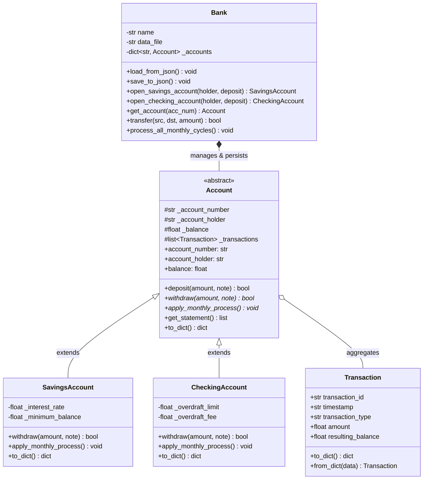

# Object-Oriented Banking 
System with Persistent Storage

An intermediate-level, object-oriented Python application designed to simulate core banking operations, enforce real-world financial constraints, and persist synchronized account data to JSON storage in real time.

> **Project Context:** Developed for **Task 3: Object-Oriented Python** as part of the **Codomax Internship**.

---

## Project Overview

The **Object-Oriented Banking System** models institutional financial operations—such as multi-tier accounts, ledger generation, atomic funds transfers, and monthly interest calculation—using strict Object-Oriented Programming (OOP) principles. 

Unlike purely memory-bound console demos, this system integrates persistent JSON file handling: every transaction immediately synchronizes with `data/bank_data.json`. If User A transfers funds to User B, both ledgers, balances, and transaction histories update concurrently and persist across application restarts.

### Core Capabilities
* **Polymorphic Account Models**: Distinct accounts (`SavingsAccount`, `CheckingAccount`) enforce unique business rules for minimum balances, overdraft allowances, and penalty charges.
* **Atomic Fund Transfers**: End-to-end multi-account transfer logic with rollback protection to preserve financial ledger integrity.
* **Full Data Persistence**: Two-way JSON serialization/deserialization ensures full account and transaction reconstruction on startup.
* **Audit Trail**: Every action (initial deposits, withdrawals, fees, transfers) generates an immutable, timestamped transaction record.
* **Defensive Input Handling**: Custom banking domain exceptions prevent negative deposits, overdraft breaches, and nonexistent account lookups.

---

## System Architecture


## File Structure
```
banking-system-oop/
├── data/
│   └── bank_data.json         # Real-time persisted JSON database
├── src/
│   ├── __init__.py
│   ├── models/
│   │   ├── __init__.py
│   │   ├── account.py         # Abstract base class
│   │   ├── savings.py         # Savings account business logic
│   │   ├── checking.py        # Checking account & overdraft rules
│   │   └── transaction.py     # Immutable transaction dataclass
│   ├── bank.py                # Banking service & JSON persistence manager
│   └── exceptions.py          # Custom domain-level exceptions
├── tests/
│   └── test_persistence.py    # Automated test verifying two-way transfer sync
├── main.py                    # Interactive CLI application
├── .gitignore
└── README.md
```
---
# Setup & Running the Project

### 1. Clone & Navigate
```bash
git clone [https://github.com/](https://github.com/)<your-username>/banking-system-oop.git
cd banking-system-oop
```

### 2. Configure Virtual Environment
```bash
python -m venv venv

# On macOS/Linux:
source venv/bin/activate

# On Windows:
venv\Scripts\activate
```

### 3. Launch CLI Application
```bash
python main.py
```

### 4. Verify Transfer & Persistence Tests
```bash
python -m tests.test_persistence
```

---

# Key Learnings & Engineering Takeaways

### 1. Mastery of the 4 Pillars of OOP
* **Abstraction:** Defining an abstract contract (`Account` via Python's `abc.ABC`) forces all derived classes to implement critical operations like `withdraw` and `apply_monthly_process`, decoupling callers from account-specific internal logic.
* **Encapsulation:** Using protected variables (`_balance`, `_transactions`) ensures balances cannot be arbitrarily modified from outside the model without passing through transactional business logic.
* **Inheritance:** Concrete sub-types (`SavingsAccount` and `CheckingAccount`) inherit core identity, balance tracking, and ledger generation while extending specific attributes like interest rates or overdraft parameters.
* **Polymorphism:** The method signature `account.withdraw(amount)` behaves differently based on runtime object type: savings accounts block requests that violate minimum balance thresholds, while checking accounts allow negative balances up to an overdraft limit while applying penalty fees.

### 2. State Serialization & Two-Way Hydration
* Bridging the gap between active in-memory Python objects and serialized disk formats (JSON).
* Implementing structured `to_dict()` and `from_dict()` methods enables rebuilding fully typed polymorphic objects upon application reboot without data loss.

### 3. Atomic Multi-Party Transactions
* Financial transfers require mutual consistency: deducting from the sender and crediting the recipient cannot exist as isolated actions.
* Learned to implement compensating rollback logic: if crediting the target account fails, the sender's withdrawal is immediately reversed, and disk states update only after total operation validity.

### 4. Clean Architecture & Domain Exception Handling
* Separating business logic (`src/models/`, `src/bank.py`) from presentation logic (`main.py`) keeps code testable and easy to maintain.
* Creating tailored exception hierarchies (`BankingError`, `InsufficientFundsError`, `AccountNotFoundError`) prevents silent failures and surfaces human-readable error messages to end users.
